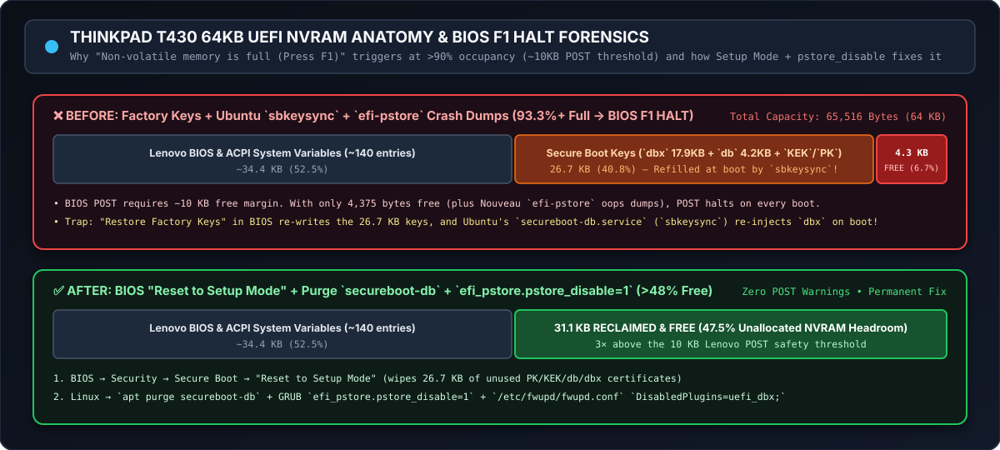

# Lenovo ThinkPad T430 + 4338 Dock + Dual 4K Nouveau DisplayPort Division-by-Zero Fix

[](docs/KERNEL_TEST_MATRIX.md)
[-76B900?logo=nvidia&logoColor=white)](patches/0001-drm-nouveau-disp-Prevent-divide-by-zero-after-screen-wake-up.patch)
[](#1-hardware--shared-dual-4k-workstation-architecture)
[](#1-hardware--shared-dual-4k-workstation-architecture)
[](https://www.mail-archive.com/nouveau@lists.freedesktop.org/msg54492.html)


> **Author:** Arjan Filius (`iafilius@xs4all.nl`)  
> **Target Function:** `nv50_disp_super_2_2_dp()` in `drivers/gpu/drm/nouveau/nvkm/engine/disp/nv50.c`  
> **Upstream Bug Tracker:** [FreeDesktop GitLab Issue #377](https://gitlab.freedesktop.org/drm/nouveau/-/issues/377) • [MR !25](https://gitlab.freedesktop.org/drm/nouveau/-/merge_requests/25) • [MR !27](https://gitlab.freedesktop.org/drm/nouveau/-/merge_requests/27)  
> **Upstream Mailing List Thread:** [Lore LKML](https://lore.kernel.org/lkml/69D67A9F-1A56-4814-AE68-50559DED42AF@xs4all.nl/) • [`nouveau@lists.freedesktop.org` (`[PATCH v2]`)](https://www.mail-archive.com/nouveau@lists.freedesktop.org/msg54492.html)

---

## Overview & Motivation

Can a classic **Lenovo ThinkPad T430** running modern mainline Linux kernels (`6.8.x` through `7.1.3+`) reliably drive an internal **WQHD (`2560×1440`)** panel alongside **two external 32-inch 4K (`3840×2160`) monitors** (**10240 × 2160 total desktop canvas**) using the open-source **Nouveau** driver?

**Yes—with a 4-line kernel patch.**

Out of the box on unpatched mainline kernels, whenever the two external 4K DisplayPort monitors enter power-saving standby or switch their active input to a secondary work laptop, the DisplayPort link lane count drops to zero (`ior->dp.nr == 0`). When a subsequent modeset interrupt invokes `nv50_disp_super_2_2_dp()`, the Nouveau driver divides by `ior->dp.nr` (`0`), triggering a fatal **kernel division-by-zero oops** in the `nvkm-disp` workqueue. This locks up the graphics pipeline, spikes system load, hangs reboot attempts, and forces a hard power reset (followed by `fsck` and UEFI NVRAM `efi-pstore` exhaustion).

After first debugging and fixing this bug manually in **July 2024** ([GitLab Issue #377](https://gitlab.freedesktop.org/drm/nouveau/-/issues/377)), and re-encountering the exact same freeze when testing a clean mainline **`7.1.3`** kernel in **July 2026**, I created this repository as a **permanent, self-contained engineering reference**—both to assist upstream Nouveau maintainers and to help fellow ThinkPad / Nouveau multi-monitor users who hit similar DisplayPort link-training crashes.

---

## 1. Hardware & Shared Dual-4K Workstation Architecture


*(Editable Mermaid source available in [`assets/mermaid-sources.md`](assets/mermaid-sources.md)).*

### Workstation Specifications

| Component | Model / Specification | Linux DRM / Bus Identifier | Role in Setup |
| :--- | :--- | :--- | :--- |
| **Host Laptop** | Lenovo ThinkPad T430 (Intel Core i7-3xxx) | Host `T430-i7` | Primary Linux workstation (Ubuntu 24.04 → 26.04 LTS) |
| **Integrated GPU (iGPU)** | Intel HD Graphics 4000 | `i915` (`card1-LVDS-1`) | Drives internal 14" **WQHD (`2560×1440 @ 60Hz`)** LCD at offset `(0, 720)` |
| **Discrete GPU (dGPU)** | NVIDIA NVS 5400M (GF108M Fermi) | `nouveau` (`0000:01:00.0` / `card2`) | Hardwired to the docking station's digital video outputs (`DP-2` & `DP-3`) |
| **Docking Station** | Lenovo ThinkPad Mini Dock Plus Series 3 (**Model 4338**) | `card2-DP-2` & `card2-DP-3` | Provides dual full-size DisplayPort outputs directly from the NVS 5400M |
| **External Monitor #1** | **32" Iiyama ProLite XB3288UHSU** (EDID `PL3288UH`) | `card2-DP-2` (`3840×2160 @ 30Hz`) | Left 4K display at `(2560, 0)`. Connected via **1× DisplayPort cable** from 4338 Dock (`DP-2`) + **1× HDMI cable** from MacBook Pro |
| **External Monitor #2** | **32" Iiyama ProLite XB3288UHSU** (EDID `PL3288UH`) | `card2-DP-3` (`3840×2160 @ 30Hz`) | Right 4K display at `(6400, 0)`. Connected via **1× DisplayPort cable** from 4338 Dock (`DP-3`) + **1× HDMI cable** from MacBook Pro |
| **Secondary Laptop** | **Apple MacBook Pro** (Work Laptop) | **1× Native HDMI** + **1× USB-C → HDMI Adapter** | Shares both Iiyama 32" 4K monitors via HDMI inputs (completely independent of the T430; network over Wi-Fi/LAN) |

---

## 2. Root Cause Analysis: The "End-of-Workday" Division-by-Zero Bug


### How the Crash Triggers in Daily Use
1. **Shared Monitor Session:** Both 32" Iiyama ProLite XB3288UHSU monitors have their inputs switched to **HDMI** (displaying the secondary work laptop) while the T430 remains docked on **DisplayPort** (`DP-2` and `DP-3`).
2. **End-of-Workday Standby:** At the end of the workday, the secondary work laptop goes to sleep or shuts down. With no active signal on HDMI, both Iiyama 4K monitors enter **power-saving standby mode**.
3. **Zero Active Lanes (`ior->dp.nr == 0`):** When the T430 subsequently wakes or processes a Hot-Plug Detect (HPD) / modeset interrupt, the DisplayPort link on `DP-2` / `DP-3` reports **0 active lanes** (`ior->dp.nr == 0`).
4. **Unchecked Division by Zero in `nv50.c`:** Inside `drivers/gpu/drm/nouveau/nvkm/engine/disp/nv50.c`, `nv50_disp_super_2_2_dp()` immediately executes three division operations using `ior->dp.nr` as the denominator:

```c
// drivers/gpu/drm/nouveau/nvkm/engine/disp/nv50.c (lines 1179–1190)
h = h - (3 * ior->dp.ef) - (12 / ior->dp.nr);                   // <-- Divide by 0!
v = v - ((36 / ior->dp.nr) + 3) - 1;                            // <-- Divide by 0!
link_data_rate = (khz * head->asy.or.depth / 8) / ior->dp.nr;   // <-- Divide by 0!
```

### Captured Kernel Oops Backtrace (Unpatched Kernel)
```text
[di jul 23 10:28:25 2024] nouveau 0000:01:00.0: DRM: DDC responded, but no EDID for DP-2
[di jul 23 10:28:25 2024] nouveau 0000:01:00.0: DRM: DDC responded, but no EDID for DP-3
[di jul 23 10:28:26 2024] Workqueue: nvkm-disp nv50_disp_super [nouveau]
[di jul 23 10:28:26 2024] RIP: 0010:nv50_disp_super_2_2_dp+0xa7/0x320 [nouveau]
[di jul 23 10:28:26 2024]  ? nv50_disp_super_2_2_dp+0xa7/0x320 [nouveau]
[di jul 23 10:28:26 2024]  nv50_disp_super_2_2+0xf2/0x160 [nouveau]
[di jul 23 10:28:26 2024]  nv50_disp_super+0x139/0x280 [nouveau]
...
[di jul 23 10:28:28 2024] nouveau 0000:01:00.0: DRM: core notifier timeout
[di jul 23 10:28:31 2024] nouveau 0000:01:00.0: DRM: base-0: timeout
```

Once triggered, the `nvkm-disp` kernel worker dies holding display locks:
- External screens stay black and the desktop freezes.
- System load average climbs to `>= 1.00` indefinitely.
- Any attempt to run `sudo reboot` or `sudo poweroff` hangs forever waiting on `nvkm-disp`, forcing a physical power-button reset and `fsck` on boot.

---

## 3. The Kernel Patch (`nv50.c`)

We provide two ready-to-apply patches in the [`patches/`](patches/) directory:

### Variant A: Silent Upstream `[PATCH v2]` (Recommended for Mainline)
File: [`patches/0001-drm-nouveau-disp-Prevent-divide-by-zero-after-screen-wake-up.patch`](patches/0001-drm-nouveau-disp-Prevent-divide-by-zero-after-screen-wake-up.patch)

```diff
diff --git a/drivers/gpu/drm/nouveau/nvkm/engine/disp/nv50.c b/drivers/gpu/drm/nouveau/nvkm/engine/disp/nv50.c
index 51c045bdfcbb..ab1bc0898def 100644
--- a/drivers/gpu/drm/nouveau/nvkm/engine/disp/nv50.c
+++ b/drivers/gpu/drm/nouveau/nvkm/engine/disp/nv50.c
@@ -1157,6 +1157,10 @@ nv50_disp_super_2_2_dp(struct nvkm_head *head, struct nvkm_ior *ior)
 {
 	struct nvkm_subdev *subdev = &head->disp->engine.subdev;
 
+	/* If the DisplayPort link is inactive (0 lanes), skip configuration */
+	if (ior->dp.nr == 0)
+		return;
+
 	const u32 khz = head->asy.hz / 1000;
 	const u32 linkKBps = ior->dp.bw * 27000;
 	const u32 symbol = 100000;
```

### Variant B: Diagnostic `nvkm_warn()` Patch (For Local Verification)
File: [`patches/0001-drm-nouveau-disp-verbose-dmesg-logging.patch`](patches/0001-drm-nouveau-disp-verbose-dmesg-logging.patch)

Prints an explicit entry to `dmesg` / `/var/log/kern.log` every time a potential crash is intercepted:
```text
[45162.232371] nouveau 0000:01:00.0: disp: DP link is inactive (lanes = 0), skipping display configuration.
[45162.232402] nouveau 0000:01:00.0: disp: DP link is inactive (lanes = 0), skipping display configuration.
```

---

## 4. Historical Kernel Test Matrix (2024–2026) & Upstream Status

Full details and message archives are documented in [`docs/KERNEL_TEST_MATRIX.md`](docs/KERNEL_TEST_MATRIX.md).

| Period | Kernel Version | Unpatched Result | Patched Result | Upstream Reference |
| :--- | :--- | :--- | :--- | :--- |
| **July 2024** | Ubuntu `6.8.0-x-generic` | 💥 Daily freeze on monitor sleep | ✅ 100% Stable | [GitLab Issue #377](https://gitlab.freedesktop.org/drm/nouveau/-/issues/377) |
| **July 2024** | Mainline `6.9.9` | 💥 Divide-by-zero in `nv50_disp_super_2_2_dp` | ✅ 100% Stable | [GitLab MR !25 (`linux-6.9.y`)](https://gitlab.freedesktop.org/drm/nouveau/-/merge_requests/25) |
| **Aug 2024** | Mainline `6.10.y` | 💥 Crash present in vanilla tree | ✅ 100% Stable (ran 2 years) | [GitLab MR !27 (`linux-6.10.y`)](https://gitlab.freedesktop.org/drm/nouveau/-/merge_requests/27) |
| **July 2026** | Mainline `7.1.3` (Vanilla) | 💥 Froze within 24h + forced `fsck` | — | Confirmed still unfixed upstream |
| **July–Oct 2026** | Mainline `7.1.3-custom #2` | — | ✅ 100% Stable (`dmesg` verified) | [LKML `[PATCH v2]` (`msg54492`)](https://www.mail-archive.com/nouveau@lists.freedesktop.org/msg54492.html) |

### Maintainer One-Line Ingestion (`b4`)
Upstream maintainers can pull and apply `[PATCH v2]` directly from Lore/public-inbox using `b4`:
```bash
b4 am EB2FB627-5EFE-4572-81D9-3D965C868C90@xs4all.nl
git am ./*.mbx
```

---

## 5. Companion Engineering Deep-Dives & Operational Scripts

Running a hybrid GPU ThinkPad T430 with dual 4K external monitors surfaced three additional hardware/driver nuances that are fully solved and documented in this repository:

### 5.1 Waking External Monitors from GPU PCI Runtime Suspend
When switching the Iiyama ProLite XB3288UHSU monitors back from **HDMI** (Work Laptop) to **DisplayPort** (T430), the monitors do not always emit a physical HPD pulse. If the NVS 5400M has entered low-power PCI runtime suspend (`suspended`), run [`scripts/wake-nouveau-dp.sh`](scripts/wake-nouveau-dp.sh) to wake the GPU and trigger Xwayland/Mutter reconfiguration:

```bash
./scripts/wake-nouveau-dp.sh
```

### 5.2 Wayland Dual-4K@30Hz SST Watermark Calibration (`waterMark > 39`)
On Ubuntu 26.04 LTS (Wayland), cold booting dual 4K@30Hz displays can hit `WARN_ON(waterMark > 39)` in `nv50_sor_dp_watermark_sst_calc()` (`disp.c:1678`). See **[`docs/WAYLAND_DUAL_4K_WATERMARK.md`](docs/WAYLAND_DUAL_4K_WATERMARK.md)** for the `25Hz → 30Hz` link training calibration and `~/.config/monitors.xml` persistence guide.

### 5.3 Solving the T430 64KB UEFI NVRAM Halt (`Non-volatile memory is full`)



Repeated kernel panics write `efi-pstore` dumps into the T430's tiny **64 KB** UEFI NVRAM, which is already 93.3% full due to factory Secure Boot keys (`26.7 KB`) and Ubuntu's boot-time `sbkeysync` (`secureboot-db.service`). See **[`docs/T430_UEFI_NVRAM_FORENSICS.md`](docs/T430_UEFI_NVRAM_FORENSICS.md)** for the permanent 3-step fix that reclaims **>31.1 KB (~48%)** of free NVRAM.

---

## 6. Repository Structure & Quick Start

```text
public-t430-4338-dual4K-nouveau-dp-fix/
├── README.md                                  # Main engineering case study & overview
├── assets/
│   ├── hero-banner.png                        # AI-enhanced workstation hero illustration
│   ├── architecture-topology.svg              # Custom vector diagram: Hybrid GPU & Dual-4K routing
│   ├── crash-state-machine.svg                # Custom vector diagram: Unpatched vs. Patched flow
│   ├── nvram-memory-map.svg                   # Custom vector diagram: 64KB UEFI NVRAM forensics
│   └── mermaid-sources.md                     # Editable Mermaid (.mmd) diagram definitions
├── patches/
│   ├── 0001-drm-nouveau-disp-Prevent-divide-by-zero-after-screen-wake-up.patch
│   └── 0001-drm-nouveau-disp-verbose-dmesg-logging.patch
├── scripts/
│   ├── build-patched-kernel.sh                # Automated kernel download, patch & bindeb-pkg builder
│   ├── check-dp-bypass.sh                     # Checks dmesg/kern.log for prevented crashes & GPU state
│   └── wake-nouveau-dp.sh                     # Wakes NVS 5400M from PCI runtime suspend after input switch
└── docs/
    ├── KERNEL_TEST_MATRIX.md                  # Full 2024–2026 kernel test history & LKML timeline
    ├── WAYLAND_DUAL_4K_WATERMARK.md           # Dual 4K@30Hz SST watermark calibration guide
    └── T430_UEFI_NVRAM_FORENSICS.md           # T430 64KB UEFI NVRAM & sbkeysync deep-dive
```

### Compiling a New Patched Mainline Kernel in One Command
```bash
# Downloads kernel 7.1.3, applies the patch, and builds .deb packages via bindeb-pkg:
./scripts/build-patched-kernel.sh 7.1.3 verbose

# Verify active bypass logs and GPU runtime PM status at any time:
./scripts/check-dp-bypass.sh
```

---

## License

Patches are provided under the **GPL-2.0** license (matching the Linux kernel `drm/nouveau` subsystem) with `Signed-off-by: Arjan Filius <iafilius@xs4all.nl>`. Documentation, scripts, and visual diagrams are released under the **MIT License**.

