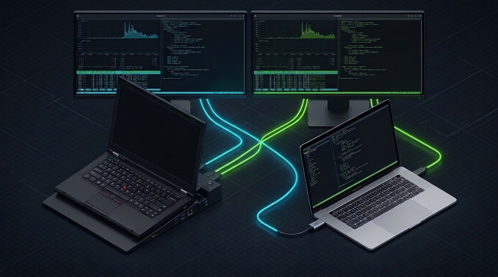
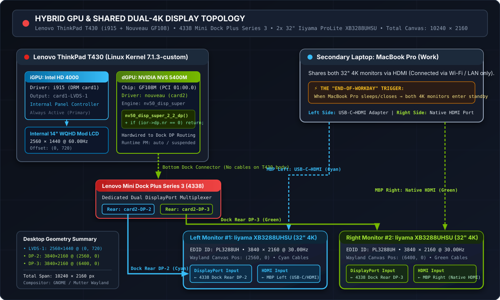
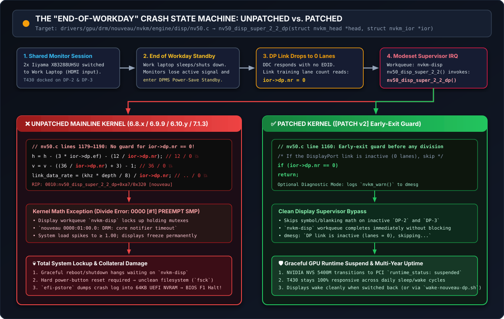

# Lenovo ThinkPad T430 + 4338 Dock + Dual 4K Nouveau DisplayPort Division-by-Zero Fix

[](docs/KERNEL_TEST_MATRIX.md)
[-76B900?logo=nvidia&logoColor=white)](patches/0001-drm-nouveau-disp-Prevent-divide-by-zero-after-screen-wake-up.patch)
[](#1-hardware--shared-dual-4k-workstation-architecture)
[](#1-hardware--shared-dual-4k-workstation-architecture)
[](https://www.mail-archive.com/nouveau@lists.freedesktop.org/msg54492.html)



> **Author:** Arjan Filius (`iafilius@xs4all.nl`)  
> **Target Function:** `nv50_disp_super_2_2_dp()` in `drivers/gpu/drm/nouveau/nvkm/engine/disp/nv50.c`  
> **Upstream Bug Tracker:** [FreeDesktop GitLab Issue #377](https://gitlab.freedesktop.org/drm/nouveau/-/issues/377) • [MR !25](https://gitlab.freedesktop.org/drm/nouveau/-/merge_requests/25) • [MR !27](https://gitlab.freedesktop.org/drm/nouveau/-/merge_requests/27)  
> **Upstream Mailing List Thread:** [Lore LKML](https://lore.kernel.org/lkml/69D67A9F-1A56-4814-AE68-50559DED42AF@xs4all.nl/) • [`nouveau@lists.freedesktop.org` (`[PATCH v2]`)](https://www.mail-archive.com/nouveau@lists.freedesktop.org/msg54492.html)

---

## Overview & Motivation

The **Lenovo ThinkPad T430** features a discrete **NVIDIA NVS 5400M (`GF108M` Fermi)** GPU wired directly to the digital display ports on the **Type 4338 Dock**. NVIDIA ended support for this chipset years ago, freezing the legacy proprietary driver at **`390.157`** (`nvidia-driver-390`) in late 2022. That left the proprietary driver as a **double dead end**:
1. **Incompatible with Newer Kernels:** Installing or updating `nvidia-dkms-390` on newer Linux kernels was never frictionless—and quite often dramatic, with DKMS build failures breaking upgrades and leaving external displays dead.
2. **Locked to Legacy Xorg/X11 (No Wayland Support):** The `390.xx` driver only supported **Xorg/X11** and had **no support for Wayland at all**, blocking any transition to a modern Linux desktop stack.

Dropping the proprietary `390.xx` driver as soon as an open-source alternative became viable was therefore an easy decision. Fortunately, the in-tree open-source **`nouveau`** driver has matured significantly. Together with **Wayland** (replacing Xorg/X11), it can drive the T430's internal **WQHD (`2560×1440`)** panel alongside **two external 32-inch 4K (`3840×2160`) monitors** (**10240 × 2160 total desktop canvas**) on modern mainline kernels (`6.8.x` through `7.1.3+`).

**Does it work? Yes—out of the box, though it only becomes 100% reliable with a small one-liner kernel patch (`if (ior->dp.nr == 0) return;`).**

Without this patch, a fatal bug occurs whenever the two external 4K DisplayPort monitors enter power-saving standby or switch their input to a secondary work laptop. During that transition, the active DisplayPort lane count drops to zero (`ior->dp.nr == 0`). When a subsequent modeset interrupt calls `nv50_disp_super_2_2_dp()`, the `nouveau` driver divides by `ior->dp.nr` (`0`). This triggers a **kernel division-by-zero oops** in the `nvkm-disp` workqueue, freezing the desktop, spiking system load, hanging `reboot`, and forcing a hard power reset (followed by `fsck` on boot).

I first debugged and fixed this crash locally in **July 2024** ([GitLab Issue #377](https://gitlab.freedesktop.org/drm/nouveau/-/issues/377)). After hitting the exact same freeze again on a clean mainline **`7.1.3`** kernel in **July 2026**, I put together this repository as a permanent, self-contained reference—both for upstream `nouveau` maintainers and for fellow ThinkPad / Linux multi-monitor users.

### Why `nouveau` + Wayland Instead of the Proprietary NVIDIA Driver? (Driver History)

For years, this ThinkPad T430 + 4338 Dock setup ran on NVIDIA's proprietary binary driver (the legacy `390.xx` series) under X11. When I first tested the open-source **`nouveau`** driver many years ago, it was completely unusable for a docked dual-monitor setup.

Over time, however, staying on the proprietary NVIDIA driver became a dead end:
1. **Abandoned by NVIDIA & Dramatic `nvidia-dkms-390` (`390.157`) Breakage:** NVIDIA dropped support for the NVS 5400M (`GF108M` Fermi) chipset years ago, freezing the legacy `390.xx` branch at version **`390.157`** (`nvidia-driver-390` / `nvidia-dkms-390`) in late 2022. Adding or keeping that package working on newer kernels (`6.5+`, `6.8+`) was never frictionless and often downright dramatic: internal kernel API changes (`nv-mm.h`, `get_user_pages`, stricter GCC pointer checks, `objtool`) caused DKMS compilation to abort mid-upgrade (`exit code 100`), leaving `apt` in a broken state and dropping the desktop to a dead external display setup unless manually patched. Dropping the proprietary driver as soon as possible was a huge relief.
2. **Imperfect Stability under X11:** Even when it compiled, the proprietary `390.xx` driver was never 100% stable on hybrid Optimus docked setups and suffered from intermittent freezes and modesetting glitches.
3. **No Wayland Support at All:** Modern Wayland compositors require **GBM (Generic Buffer Management)**, `DMA-BUF` cross-GPU Reverse PRIME offloading, and hardware-accelerated Xwayland. NVIDIA only added Xwayland acceleration in the `470.xx` series and GBM in the `495.xx` series. The legacy **`390.xx`** driver supports none of these, making a modern Wayland session across the Intel iGPU (`i915`) and NVIDIA dock outputs impossible.
4. **The 2024 `nouveau` + Wayland Breakthrough:** Because **`nouveau`** is built directly on the standard Linux DRM/KMS, **GBM**, and **DMA-BUF** stack, re-testing it in **2024** was a revelation. Out of the box, `nouveau` + **Wayland** drove the internal `i915` WQHD screen and both external `nouveau` 4K@30Hz DisplayPort monitors smoothly. The only showstopper was the `nv50_disp_super_2_2_dp()` division-by-zero crash on monitor standby—and with this small one-liner kernel patch applied, the setup has been rock-solid in daily production use ever since.

---

## 1. Hardware & Shared Dual-4K Workstation Architecture



*(Editable Mermaid source available in [`assets/mermaid-sources.md`](assets/mermaid-sources.md)).*

### Workstation Specifications

| Component | Model / Specification | Linux DRM / Bus Identifier | Role in Setup |
| :--- | :--- | :--- | :--- |
| **Host Laptop** | Lenovo ThinkPad T430 (Intel Core i7-3xxx) | Host `T430-i7` | Primary Linux workstation (Ubuntu 24.04 → 26.04 LTS) |
| **Integrated GPU (iGPU)** | Intel HD Graphics 4000 | `i915` (`card1-LVDS-1`) | Drives internal 14" **WQHD (`2560×1440 @ 60Hz`)** LCD at offset `(0, 720)` |
| **Discrete GPU (dGPU)** | NVIDIA NVS 5400M (GF108M Fermi) | `nouveau` (`0000:01:00.0` / `card2`) | Hardwired to the docking station's digital video outputs (`DP-2` & `DP-3`) |
| **Docking Station** | Lenovo ThinkPad Mini Dock Plus Series 3 (**Type 4338**) | `card2-DP-2` & `card2-DP-3` | Provides **2× DisplayPort**, **2× DVI-D**, **1× VGA**, 6× USB, GbE ([Lenovo Reference Guide HT508937](https://support.lenovo.com/ca/en/solutions/ht508937-mini-docks-reference-guide)) |
| **External Monitor #1** | **32" Iiyama ProLite XB3288UHSU** (EDID `PL3288UH`) | `card2-DP-2` (`3840×2160 @ 30Hz`) | Left 4K display at `(2560, 0)`. Connected via **1× DisplayPort cable** from 4338 Dock (`DP-2`) + **1× HDMI cable** from MacBook Pro (left USB-C/HDMI adapter) |
| **External Monitor #2** | **32" Iiyama ProLite XB3288UHSU** (EDID `PL3288UH`) | `card2-DP-3` (`3840×2160 @ 30Hz`) | Right 4K display at `(6400, 0)`. Connected via **1× DisplayPort cable** from 4338 Dock (`DP-3`) + **1× HDMI cable** from MacBook Pro (right native HDMI) |
| **Secondary Laptop** | **Apple MacBook Pro** (Work Laptop) | **1× USB-C → HDMI Adapter (Left)** + **1× Native HDMI (Right)** | Shares both Iiyama 32" 4K monitors via their HDMI inputs (no cable between laptops; network via Wi-Fi/LAN) |

### Lenovo ThinkPad Mini Dock Plus Series 3 (Type 4338) Video Port Architecture

Per Lenovo's official [Mini Docks Reference Guide (HT508937)](https://support.lenovo.com/ca/en/solutions/ht508937-mini-docks-reference-guide), the **Type 4338** dock features **five physical video connectors** on its rear backplane, grouped into shared digital output channels wired directly to the ThinkPad T430's discrete **NVIDIA NVS 5400M** GPU:

| Dock Video Channel | Physical Connectors on 4338 Rear | Mutually Exclusive Pairing Rule | Status in This Dual-4K Setup |
| :--- | :--- | :--- | :--- |
| **Digital Channel #1** | **DisplayPort 1** (`card2-DP-2`) + **DVI-D 1** (Single-Link) | Shared internal lanes: either **DP 1** *or* **DVI-D 1** can be active (passive DP++ to HDMI/DVI supported). | **Active on `DP-2`** → Left 32" Iiyama XB3288UHSU (`3840×2160 @ 30Hz`) |
| **Digital Channel #2** | **DisplayPort 2** (`card2-DP-3`) + **DVI-D 2** (Single-Link) | Shared internal lanes: either **DP 2** *or* **DVI-D 2** can be active (passive DP++ to HDMI/DVI supported). | **Active on `DP-3`** → Right 32" Iiyama XB3288UHSU (`3840×2160 @ 30Hz`) |
| **Analog Channel** | **1× VGA** (DE-15, up to `1920×1200`) | Independent analog DAC output. | Unused |
| **Laptop Internal Panel** | **Internal 14" LVDS** (`card1-LVDS-1`) | Driven by **Intel HD 4000 (`i915`)** via NVIDIA Optimus / PRIME. | **Active** → Internal WQHD LCD (`2560×1440 @ 60Hz`) |

> **Why NVIDIA Optimus Matters Here:** On the ThinkPad T430, the 4338 Dock's digital outputs (`2× DisplayPort` and `2× DVI-D`) are physically routed to the discrete NVIDIA NVS 5400M rather than the Intel iGPU. You cannot drive the dock's DisplayPort monitors using `i915` alone—`nouveau` (or the legacy NVIDIA driver) must be active to light up external digital displays through the dock.

### Pushing Beyond Official 2012 Specs: Dual 4K@30Hz at the Hardware Ceiling

When the **ThinkPad T430** and **Type 4338 Dock** launched in 2012, Lenovo's official datasheet rated the DisplayPort outputs for a maximum resolution of **`2560×1600 @ 60Hz`**. Driving **two external 32" 4K (`3840×2160`) monitors simultaneously** through the dock—alongside an upgraded internal **`2560×1440` WQHD** panel—goes well beyond the original factory specifications:

- At **`30Hz`** (`262.75 MHz` pixel clock per monitor over 4-lane HBR DisplayPort 1.1a), **`2× 3840×2160 @ 30Hz` + `2560×1440 @ 60Hz` (`10240 × 2160` total desktop)** represents the **absolute physical ceiling** of what the NVS 5400M (`GF108M`) display engine and 4338 Dock DisplayPort lanes can handle.
- And it **actually works remarkably well** for daily productivity and engineering workflows.
- **Most importantly:** Even when hardware is pushed to its absolute maximum bandwidth through a docking station, **the Linux kernel must never panic or divide by zero (`ior->dp.nr == 0`) simply because a connected monitor enters power-save standby or switches its input source.** Gracefully skipping DisplayPort symbol timing calculations when `ior->dp.nr == 0` ensures the kernel remains 100% crash-proof across every monitor sleep, wake, and input-switch event.

---

## 2. Root Cause Analysis: The "End-of-Workday" Division-by-Zero Bug



### How the Crash Triggers in Daily Use
1. **Shared Monitor Session:** Both 32" Iiyama ProLite XB3288UHSU monitors have their inputs switched to **HDMI** (displaying the secondary work laptop) while the T430 remains docked on **DisplayPort** (`DP-2` and `DP-3`).
2. **End-of-Workday Standby:** At the end of the workday, the secondary work laptop goes to sleep or shuts down. With no active signal on HDMI, both Iiyama 4K monitors enter **power-saving standby mode**.
3. **Zero Active Lanes (`ior->dp.nr == 0`):** When the T430 subsequently wakes or processes a Hot-Plug Detect (HPD) / modeset interrupt, the DisplayPort link on `DP-2` / `DP-3` reports **0 active lanes** (`ior->dp.nr == 0`).
4. **Unchecked Division by Zero in `nv50.c`:** Inside `drivers/gpu/drm/nouveau/nvkm/engine/disp/nv50.c`, `nv50_disp_super_2_2_dp()` immediately executes three division operations using `ior->dp.nr` as the denominator:

```c
// drivers/gpu/drm/nouveau/nvkm/engine/disp/nv50.c (lines 1179–1190)
h = h - (3 * ior->dp.ef) - (12 / ior->dp.nr);                   // <-- Divide by 0!
v = v - ((36 / ior->dp.nr) + 3) - 1;                            // <-- Divide by 0!
link_data_rate = (khz * head->asy.or.depth / 8) / ior->dp.nr;   // <-- Divide by 0!
```

### Captured Kernel Oops Backtrace (Unpatched Kernel)
```text
[di jul 23 10:28:25 2024] nouveau 0000:01:00.0: DRM: DDC responded, but no EDID for DP-2
[di jul 23 10:28:25 2024] nouveau 0000:01:00.0: DRM: DDC responded, but no EDID for DP-3
[di jul 23 10:28:26 2024] Workqueue: nvkm-disp nv50_disp_super [nouveau]
[di jul 23 10:28:26 2024] RIP: 0010:nv50_disp_super_2_2_dp+0xa7/0x320 [nouveau]
[di jul 23 10:28:26 2024]  ? nv50_disp_super_2_2_dp+0xa7/0x320 [nouveau]
[di jul 23 10:28:26 2024]  nv50_disp_super_2_2+0xf2/0x160 [nouveau]
[di jul 23 10:28:26 2024]  nv50_disp_super+0x139/0x280 [nouveau]
...
[di jul 23 10:28:28 2024] nouveau 0000:01:00.0: DRM: core notifier timeout
[di jul 23 10:28:31 2024] nouveau 0000:01:00.0: DRM: base-0: timeout
```

Once triggered, the `nvkm-disp` kernel worker dies holding display locks:
- External screens stay black and the desktop freezes.
- System load average climbs to `>= 1.00` indefinitely.
- Any attempt to run `sudo reboot` or `sudo poweroff` hangs forever waiting on `nvkm-disp`, forcing a physical power-button reset and `fsck` on boot.

### How We Tracked It Down: `gdb`, `objdump`, and the `kgdboe` Remote Debugging Dead-End

*(Full forensic notes and transcripts in **[`docs/KERNEL_DEBUGGING_JOURNEY.md`](docs/KERNEL_DEBUGGING_JOURNEY.md)**).*

Finding the exact root cause in **July–August 2024** took several iterations of kernel debugging—including a memorable dead end with remote kernel debugging over Ethernet:

1. **Why `gdb vmlinux` Didn't Work at First:**
   Initially, running `gdb /usr/lib/debug/vmlinux-6.9.9-custom` and `list *(nv50_disp_super_2_2+0x284)` returned `No symbol "nv50_disp_super_2_2" in current context` because `nouveau` is compiled as a loadable kernel module (`CONFIG_DRM_NOUVEAU=m`), not built into `vmlinux`.
2. **Pinpointing the Exact C Line via `nv50.o` (`gdb` + `objdump -SdCg`):**
   Pointing `objdump -SdCg nv50.o` and `gdb drivers/gpu/drm/nouveau/nvkm/engine/disp/nv50.o` directly at the compiled module object file resolved the instruction pointer (`nv50_disp_super_2_2+0x284`, where the static `nv50_disp_super_2_2_dp` function had been inlined) straight to `nv50.c:1092–1097`:
   ```text
   (gdb) list *(nv50_disp_super_2_2+0x284)
   0x3f84 is in nv50_disp_super_2_2 (drivers/gpu/drm/nouveau/nvkm/engine/disp/nv50.c:1094).
   1092        v = v - ((36 / ior->dp.nr) + 3) - 1;
   ...
   1097        link_data_rate = (khz * head->asy.or.depth / 8) / ior->dp.nr;
   ```
3. **The Remote Kernel Debugging Dead-End (`kgdboe` over UDP):**
   To inspect live kernel state when the T430 froze, we compiled [`sysprogs/kgdboe`](https://github.com/sysprogs/kgdboe) (Kernel GDB over Ethernet) against `6.10.2-custom` and loaded it via `kallsyms_lookup_name` (`insmod kgdboe.ko ... device_name=eth0`). While `kgdboe` successfully offlined CPUs 1–7 into single-core mode and opened `udp:192.168.1.57:31337`, attaching GDB from a second machine (`target remote udp:192.168.1.57:31337`) immediately failed with:
   ```text
   warning: The remote protocol may be unreliable over UDP.
   Malformed response to offset query, QCfffffffe
   ```
   and **hard-locked the target T430 kernel completely** on the very first UDP handshake. Remote kernel debugging over UDP proved to be a complete dead end on modern `6.10.x` kernels.
4. **Testing Candidate Patches & Refining the Fix:**
   - We first tested commenting out `drm_dp_dpcd_set_powered(&nv_connector->aux, false)` in `nouveau_dp.c` (suggested during early [GitLab Issue #377](https://gitlab.freedesktop.org/drm/nouveau/-/issues/377) debugging), which did **not** stop `ior->dp.nr` from dropping to `0`.
   - We then added a caller-side guard in `nv50_disp_super_2_2()` logging `nvkm_error(subdev, "ArFi: ior->dp.nr == 0\n")`, which immediately confirmed `ior->dp.nr == 0` in `dmesg` and eliminated the crash! That prototype was subsequently refined into the clean early-return inside `nv50_disp_super_2_2_dp()` below.
   - Along the way, while inspecting `/sys/devices/pci0000:00/.../graphics/fb1` when monitors stayed asleep after switching inputs back from the MacBook Pro, running `lshw -c video` unexpectedly woke up the GPU and lit up both 4K screens—inspiring [`scripts/wake-nouveau-dp.sh`](scripts/wake-nouveau-dp.sh).

---

## 3. The Kernel Patch (`nv50.c`)

We provide two ready-to-apply patches in the [`patches/`](patches/) directory:

### Variant A: Silent Upstream `[PATCH v2]` (Recommended for Mainline)
File: [`patches/0001-drm-nouveau-disp-Prevent-divide-by-zero-after-screen-wake-up.patch`](patches/0001-drm-nouveau-disp-Prevent-divide-by-zero-after-screen-wake-up.patch)

```diff
diff --git a/drivers/gpu/drm/nouveau/nvkm/engine/disp/nv50.c b/drivers/gpu/drm/nouveau/nvkm/engine/disp/nv50.c
index 51c045bdfcbb..ab1bc0898def 100644
--- a/drivers/gpu/drm/nouveau/nvkm/engine/disp/nv50.c
+++ b/drivers/gpu/drm/nouveau/nvkm/engine/disp/nv50.c
@@ -1157,6 +1157,10 @@ nv50_disp_super_2_2_dp(struct nvkm_head *head, struct nvkm_ior *ior)
 {
 	struct nvkm_subdev *subdev = &head->disp->engine.subdev;
 
+	/* If the DisplayPort link is inactive (0 lanes), skip configuration */
+	if (ior->dp.nr == 0)
+		return;
+
 	const u32 khz = head->asy.hz / 1000;
 	const u32 linkKBps = ior->dp.bw * 27000;
 	const u32 symbol = 100000;
```

### Variant B: Diagnostic `nvkm_warn()` Patch (For Local Verification)
File: [`patches/0001-drm-nouveau-disp-verbose-dmesg-logging.patch`](patches/0001-drm-nouveau-disp-verbose-dmesg-logging.patch)

Prints an explicit entry to `dmesg` / `/var/log/kern.log` every time a potential crash is intercepted:
```text
[45162.232371] nouveau 0000:01:00.0: disp: DP link is inactive (lanes = 0), skipping display configuration.
[45162.232402] nouveau 0000:01:00.0: disp: DP link is inactive (lanes = 0), skipping display configuration.
```

---

## 4. Historical Kernel Test Matrix (2024–2026) & Upstream Status

Full details and message archives are documented in [`docs/KERNEL_TEST_MATRIX.md`](docs/KERNEL_TEST_MATRIX.md).

| Period | Kernel Version | Unpatched Result | Patched Result | Upstream Reference |
| :--- | :--- | :--- | :--- | :--- |
| **July 2024** | Ubuntu `6.8.0-x-generic` | 💥 Daily freeze on monitor sleep | ✅ 100% Stable | [GitLab Issue #377](https://gitlab.freedesktop.org/drm/nouveau/-/issues/377) |
| **July 2024** | Mainline `6.9.9` | 💥 Divide-by-zero in `nv50_disp_super_2_2_dp` | ✅ 100% Stable | [GitLab MR !25 (`linux-6.9.y`)](https://gitlab.freedesktop.org/drm/nouveau/-/merge_requests/25) |
| **Aug 2024** | Mainline `6.10.y` | 💥 Crash present in vanilla tree | ✅ 100% Stable (ran 2 years) | [GitLab MR !27 (`linux-6.10.y`)](https://gitlab.freedesktop.org/drm/nouveau/-/merge_requests/27) |
| **July 2026** | Mainline `7.1.3` (Vanilla) | 💥 Froze within 24h + forced `fsck` | — | Confirmed still unfixed upstream |
| **July–Oct 2026** | Mainline `7.1.3-custom #2` | — | ✅ 100% Stable (`dmesg` verified) | [LKML `[PATCH v2]` (`msg54492`)](https://www.mail-archive.com/nouveau@lists.freedesktop.org/msg54492.html) |

### Maintainer One-Line Ingestion (`b4`)
Upstream maintainers can pull and apply `[PATCH v2]` directly from Lore/public-inbox using `b4`:
```bash
b4 am EB2FB627-5EFE-4572-81D9-3D965C868C90@xs4all.nl
git am ./*.mbx
```

---

## 5. Companion Engineering Deep-Dives & Operational Scripts

Running a hybrid GPU ThinkPad T430 with dual 4K external monitors surfaced two additional DisplayPort/driver nuances that are fully solved and documented in this repository:

### 5.1 Waking External Monitors from GPU PCI Runtime Suspend
When switching the Iiyama ProLite XB3288UHSU monitors back from **HDMI** (MacBook Pro) to **DisplayPort** (T430), the monitors do not always emit a physical HPD pulse. If the NVS 5400M has entered low-power PCI runtime suspend (`suspended`), run [`scripts/wake-nouveau-dp.sh`](scripts/wake-nouveau-dp.sh) to wake the GPU and trigger Xwayland/Mutter reconfiguration:

```bash
./scripts/wake-nouveau-dp.sh
```

### 5.2 Wayland Dual-4K@30Hz SST Watermark Calibration (`waterMark > 39`)
On Ubuntu 26.04 LTS (Wayland), cold booting dual 4K@30Hz displays can hit `WARN_ON(waterMark > 39)` in `nv50_sor_dp_watermark_sst_calc()` (`disp.c:1678`). See **[`docs/WAYLAND_DUAL_4K_WATERMARK.md`](docs/WAYLAND_DUAL_4K_WATERMARK.md)** for the `25Hz → 30Hz` link training calibration and `~/.config/monitors.xml` persistence guide.

---

## 6. Repository Structure & Quick Start

```text
public-t430-4338-dual4K-nouveau-dp-fix/
├── README.md                                  # Main engineering case study & overview
├── assets/
│   ├── hero-banner.png                        # AI-enhanced workstation hero illustration
│   ├── architecture-topology.svg              # Custom vector diagram: Hybrid GPU & Dual-4K routing
│   ├── crash-state-machine.svg                # Custom vector diagram: Unpatched vs. Patched flow
│   └── mermaid-sources.md                     # Editable Mermaid (.mmd) diagram definitions
├── patches/
│   ├── 0001-drm-nouveau-disp-Prevent-divide-by-zero-after-screen-wake-up.patch
│   └── 0001-drm-nouveau-disp-verbose-dmesg-logging.patch
├── scripts/
│   ├── build-patched-kernel.sh                # Automated kernel download, patch & bindeb-pkg builder
│   ├── check-dp-bypass.sh                     # Checks dmesg/kern.log for prevented crashes & GPU state
│   └── wake-nouveau-dp.sh                     # Wakes NVS 5400M from PCI runtime suspend after input switch
└── docs/
    ├── KERNEL_DEBUGGING_JOURNEY.md            # 2024 GDB, objdump & kgdboe remote debugging forensics
    ├── KERNEL_TEST_MATRIX.md                  # Full 2024–2026 kernel test history & LKML timeline
    └── WAYLAND_DUAL_4K_WATERMARK.md           # Dual 4K@30Hz SST watermark calibration guide
```

### Compiling a New Patched Mainline Kernel in One Command
```bash
# Downloads kernel 7.1.3, applies the patch, and builds .deb packages via bindeb-pkg:
./scripts/build-patched-kernel.sh 7.1.3 verbose

# Verify active bypass logs and GPU runtime PM status at any time:
./scripts/check-dp-bypass.sh
```

---

## License

Patches are provided under the **GPL-2.0** license (matching the Linux kernel `drm/nouveau` subsystem) with `Signed-off-by: Arjan Filius <iafilius@xs4all.nl>`. Documentation, scripts, and visual diagrams are released under the **MIT License**.

