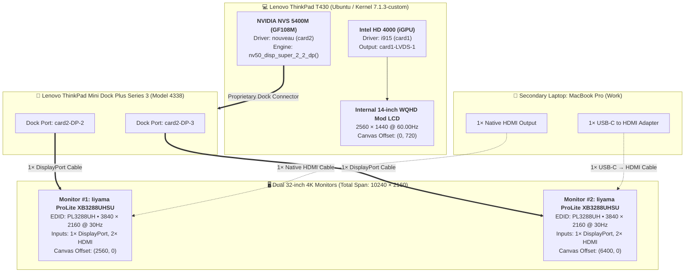
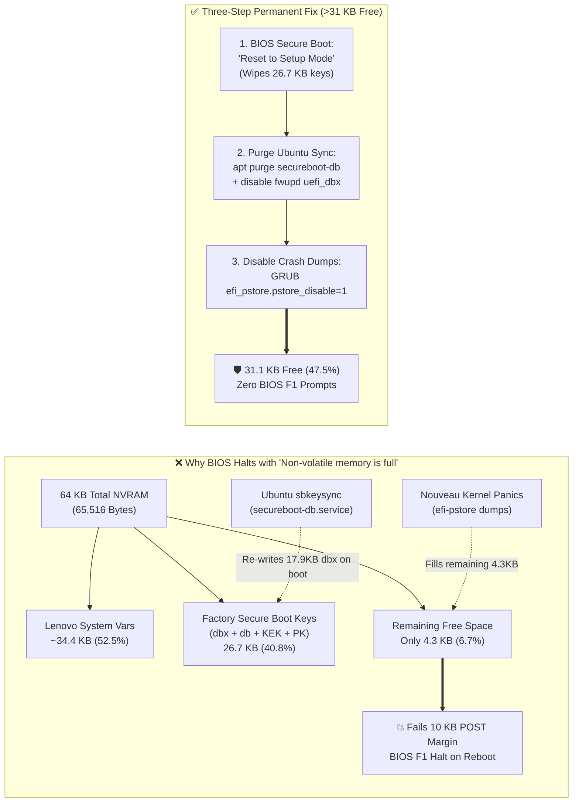

# Editable Mermaid Source Diagrams

This file preserves the editable [Mermaid](https://mermaid.js.org/) definitions corresponding to the custom high-resolution SVG infographics in `assets/`. GitHub renders these blocks natively as well.

---

## 1. Hybrid GPU & Shared Dual-4K Display Topology



---

## 2. The "End-of-Workday" DisplayPort Link Training Crash Sequence

```mermaid
sequenceDiagram
    autonumber
    participant WL as Secondary Work Laptop (HDMI)
    participant MON as 2x Iiyama XB3288UHSU (4K)
    participant DOCK as 4338 Dock (DP-2 / DP-3)
    participant NV as Nouveau Driver (nv50_disp_super_2_2_dp)
    participant OS as Linux Kernel / System State

    Note over WL,MON: Workday Session: Monitors switched to HDMI Input
    WL->>MON: Workday ends -> Work laptop enters sleep / shuts down
    MON->>DOCK: No active HDMI signal -> Monitors enter Power-Save Standby
    DOCK->>NV: HPD / Modeset Interrupt triggered on T430 wake-up
    Note over DOCK,NV: Active DisplayPort lane count drops to 0 (ior->dp.nr == 0)

    alt Unpatched Mainline Kernel (6.8.x / 6.9.9 / 6.10.y / 7.1.3)
        NV->>NV: Executes (12 / ior->dp.nr) and (36 / ior->dp.nr)
        NV--xOS: 💥 Divide-by-zero Kernel Oops in nvkm-disp workqueue!
        OS--xOS: 💀 Screen freeze, system load >= 1.0, reboot hangs -> Hard reset + fsck!
    else Patched Kernel ([PATCH v2] Early-Exit Guard)
        NV->>NV: Checks `if (ior->dp.nr == 0) return;`
        NV->>OS: ✅ Safely aborts DP symbol math on inactive link
        OS->>OS: 🛡️ NVS 5400M enters PCI runtime_status = suspended cleanly
    end
```

---

## 3. ThinkPad T430 64KB UEFI NVRAM Exhaustion & Recovery Flow



