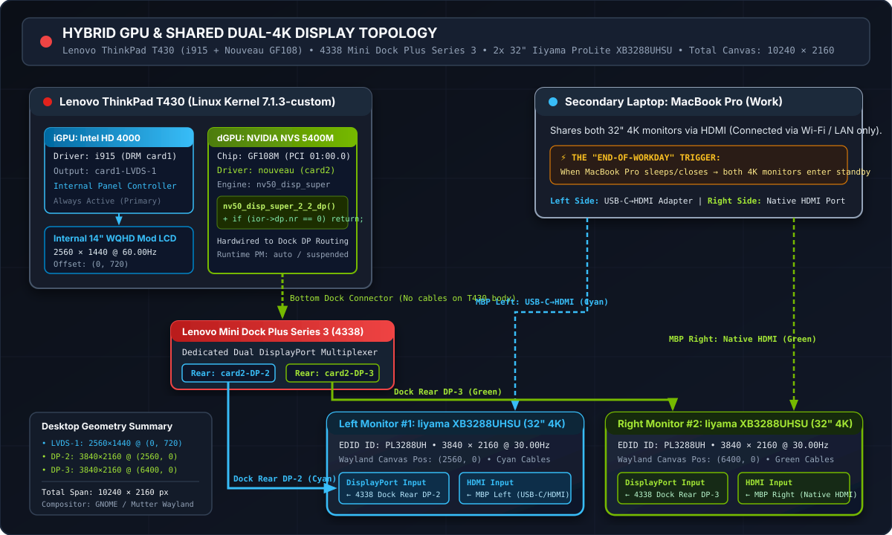

# Hardware Setup, 4338 Dock Architecture & Driver History (`nvidia-390` to `nouveau` + Wayland)

This document covers the hardware details of the ThinkPad T430 dual-4K workstation, the port routing on the Lenovo Type 4338 Dock, and the background on switching from NVIDIA's legacy `390.157` proprietary driver to the in-tree `nouveau` driver with Wayland.

---

## 1. Workstation & Shared Monitor Setup

| Component | Model / Details | Linux DRM / Connector | Notes |
| :--- | :--- | :--- | :--- |
| **Laptop** | Lenovo ThinkPad T430 (Core i7-3xxx) | Host `T430-i7` | Primary Linux machine (Ubuntu 24.04 → 26.04 LTS) |
| **Integrated GPU** | Intel HD Graphics 4000 | `i915` (`card1-LVDS-1`) | Drives the internal 14" **WQHD (`2560×1440 @ 60Hz`)** panel at `(0, 720)` |
| **Discrete GPU** | NVIDIA NVS 5400M (`GF108M` Fermi) | `nouveau` (`0000:01:00.0` / `card2`) | Wired directly to the digital display ports on the docking station |
| **Docking Station** | Lenovo ThinkPad Mini Dock Plus Series 3 (**Type 4338**) | `card2-DP-2` & `card2-DP-3` | Rear panel provides **2× DisplayPort**, **2× DVI-D**, **1× VGA**, 6× USB, GbE ([Lenovo Guide HT508937](https://support.lenovo.com/ca/en/solutions/ht508937-mini-docks-reference-guide)) |
| **Left 4K Monitor** | **32" Iiyama ProLite XB3288UHSU** (`PL3288UH`) | `card2-DP-2` (`3840×2160 @ 30Hz`) | Offset `(2560, 0)`. Connected via **1× DisplayPort** from the 4338 Dock + **1× HDMI** from the MacBook Pro (left USB-C adapter) |
| **Right 4K Monitor** | **32" Iiyama ProLite XB3288UHSU** (`PL3288UH`) | `card2-DP-3` (`3840×2160 @ 30Hz`) | Offset `(6400, 0)`. Connected via **1× DisplayPort** from the 4338 Dock + **1× HDMI** from the MacBook Pro (right native HDMI) |
| **Work Laptop** | **Apple MacBook Pro** | 1× USB-C → HDMI (left) + 1× native HDMI (right) | Shares both 4K monitors via their HDMI inputs. No direct cable between laptops (networked over Wi-Fi/LAN) |

---

## 2. Lenovo Type 4338 Dock Video Port Routing

According to Lenovo's [Mini Docks Reference Guide (HT508937)](https://support.lenovo.com/ca/en/solutions/ht508937-mini-docks-reference-guide), the **Type 4338** dock has five video connectors on the back, grouped into two digital channels and one analog output.

On Optimus-equipped ThinkPads like the T430, the dock's digital outputs are wired to the discrete **NVIDIA NVS 5400M** rather than the Intel iGPU. That means the Intel `i915` driver alone cannot drive external digital monitors on the dock; `nouveau` (or the legacy NVIDIA driver) must be active.

| Video Channel | Rear Connectors on 4338 Dock | Channel Pairing Rule | How It Is Used Here |
| :--- | :--- | :--- | :--- |
| **Digital Channel 1** | **DisplayPort 1** (`card2-DP-2`) + **DVI-D 1** (Single-Link) | Shared channel: use either **DP 1** *or* **DVI-D 1** (supports DP++ passive HDMI/DVI adapters). | **Active on `DP-2`** → Left 32" Iiyama 4K (`3840×2160 @ 30Hz`) |
| **Digital Channel 2** | **DisplayPort 2** (`card2-DP-3`) + **DVI-D 2** (Single-Link) | Shared channel: use either **DP 2** *or* **DVI-D 2** (supports DP++ passive HDMI/DVI adapters). | **Active on `DP-3`** → Right 32" Iiyama 4K (`3840×2160 @ 30Hz`) |
| **Analog Channel** | **1× VGA** (up to `1920×1200`) | Independent analog output. | Unused |
| **Internal Panel** | **14" LVDS** (`card1-LVDS-1`) | Driven by **Intel HD 4000 (`i915`)**. | **Active** → Internal WQHD panel (`2560×1440 @ 60Hz`) |

---

## 3. Running Above Official 2012 Specs: Dual 4K@30Hz as the Hardware Limit

When the ThinkPad T430 and Type 4338 Dock came out in 2012, Lenovo's datasheet listed a maximum DisplayPort resolution of **`2560×1600 @ 60Hz`**. Running **two external 32" 4K (`3840×2160`) screens** at the same time—plus an upgraded **`2560×1440`** internal panel—is well beyond what the system was originally rated for.

In practice:
- At **`30Hz`** (`262.75 MHz` pixel clock per monitor over 4-lane HBR DisplayPort 1.1a), **`2× 3840×2160 @ 30Hz` + `2560×1440 @ 60Hz` (`10240 × 2160` total desktop)** is the physical ceiling of what the NVS 5400M display engine and 4338 Dock can handle.
- For coding, terminal work, and daily office use, `30Hz` works fine on both 4K panels.
- **Why this matters for the kernel:** Switching the monitors to a second laptop on HDMI, letting them fall asleep into power-save, and switching back to the T430 creates a corner case where the laptop is not properly informed/polled of the link state (`DRM: DDC responded, but no EDID`) and assumes the monitor is active while `ior->dp.nr == 0`. Whether that state mismatch comes from the monitor firmware or the driver's polling logic, **the Linux kernel must never crash with a division-by-zero oops on it.** Skipping the DisplayPort calculation when `ior->dp.nr == 0` keeps the system stable across every input-switch and monitor power-save cycle.

---

## 4. Driver History: Why I Dropped `nvidia-driver-390` (`390.157`) for `nouveau` + Wayland

For years, I ran this T430 + 4338 Dock setup on NVIDIA's proprietary binary driver under Xorg/X11. I had tried the open-source **`nouveau`** driver a long time ago, and back then it was not usable at all for my docked multi-monitor setup.

Over the last few years, however, staying on the proprietary NVIDIA driver became a dead end for two main reasons:

### 4.1 End-of-Life Hardware & Painful `nvidia-dkms-390` (`390.157`) Upgrades
NVIDIA ended support for the Fermi (`GF108M` / NVS 5400M) architecture years ago, freezing the legacy `390.xx` branch at version **`390.157`** (`nvidia-driver-390` / `nvidia-dkms-390`) in late 2022.

On newer Linux kernels (`6.5+`, `6.8+`), installing or updating the `nvidia-dkms-390` package was rarely smooth and often a mess. Internal kernel API changes (`nv-mm.h`, `get_user_pages`, stricter GCC pointer checks, and `objtool` validation) regularly broke DKMS compilation mid-upgrade (`exit code 100`), leaving `apt` in a broken state and leaving the external monitors black until manually patched. Even when it did compile, the `390.xx` driver was never completely stable on hybrid Optimus dock setups and had its own occasional glitches.

### 4.2 Locked to Legacy Xorg/X11 (No Wayland Support)
The `390.157` driver only supports **Xorg/X11** and has **no support for modern Wayland at all**:
- Modern Wayland compositors (such as GNOME/Mutter and KDE Plasma) require **GBM (Generic Buffer Management)**, `DMA-BUF` cross-GPU Reverse PRIME buffer sharing (so the Intel iGPU and NVIDIA dock outputs can work together), and hardware-accelerated Xwayland.
- NVIDIA only added Xwayland acceleration in the `470.xx` driver series and GBM support in the `495.xx` series.
- Because the `390.xx` branch predates all of these, moving from Xorg/X11 to Wayland is impossible on the proprietary driver.

### 4.3 Switching to `nouveau` + Wayland in 2024
Because keeping `nvidia-driver-390` alive was so much trouble, dropping it as soon as a working alternative existed was an easy call.

When I tested the in-tree **`nouveau`** driver again in **2024**, the situation had changed completely. Because `nouveau` uses standard Linux DRM/KMS, **GBM**, and **DMA-BUF**, it worked out of the box with **Wayland** across the internal `i915` WQHD screen and both external `nouveau` 4K@30Hz DisplayPort monitors. The only remaining problem was the `nv50_disp_super_2_2_dp()` division-by-zero crash whenever the monitors went into standby—which the one-liner patch in this repository fixes.

