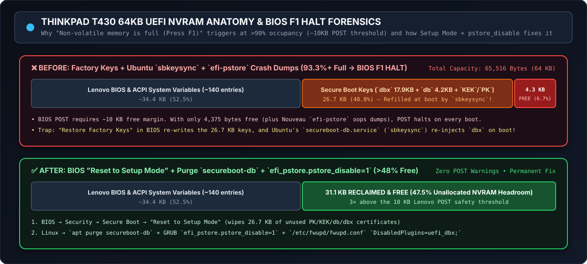

# ThinkPad T430 64KB UEFI NVRAM Exhaustion Forensics (`Non-volatile memory is full`)



A frequent collateral symptom of repeated Nouveau kernel panics on the **Lenovo ThinkPad T430** is a BIOS POST halt on reboot:

> **`Non-volatile memory is full. Press F1 to enter setup / F2 to resume.`**

Even after clearing `/sys/fs/pstore/*`, many ThinkPad T430 owners find that the F1 halt returns on the very next reboot. Below is the complete forensic breakdown of why this happens and how to eliminate it permanently.

---

## 1. The 64KB Hardware Ceiling & The 10KB POST Margin

The ThinkPad T430 SPI flash dedicates exactly **64 KB (`65,516 bytes`)** of non-volatile storage to UEFI variables (`efivarfs`).

During BIOS POST, Lenovo's firmware checks that at least **~10 KB** of unallocated NVRAM headroom remains available before booting the OS. If free space drops below ~10 KB (>85–90% full), POST halts with the F1 warning.

### Where the 64 KB Goes:
1. **Lenovo ACPI & System Variables (~140 entries):** `~34.4 KB` (`52.5%`)
2. **UEFI Secure Boot Signature Databases (`PK`, `KEK`, `db`, `dbx`):** `~26.7 KB` (`40.8%`)
   - `dbx` (Forbidden Signature Revocation List): `17.9 KB` (or up to `30.7 KB` with newer Microsoft updates)
   - `db` (Authorized Signature Database): `4.2 KB`
   - `KEK` + `PK`: `3.5 KB`
3. **Remaining Free Headroom:** **Only `4,375 bytes` (`4.3 KB`, `6.7%` free!)**

Because only `4.3 KB` is free when factory Secure Boot keys are loaded, **any** kernel crash dump written by `efi-pstore`—or even the `dbx` database by itself—pushes NVRAM usage to **93.3%+**, tripping the BIOS F1 halt on every reboot.

---

## 2. Two Hidden Traps That Defeat Naive Cleanup

### Trap A: BIOS "Restore Factory Keys"
Selecting **"Restore Factory Keys"** in the T430 BIOS writes the full `26.7 KB` certificate bundle right back into NVRAM, leaving only `4.3 KB` free and guaranteeing the F1 halt persists.

### Trap B: Ubuntu's `secureboot-db.service` (`sbkeysync`)
Even if you wipe the keys in BIOS, Ubuntu runs a boot-time systemd service (`/lib/systemd/system/secureboot-db.service`) that executes:

```bash
/usr/bin/sbkeysync --no-default-keystores --keystore /usr/share/secureboot/updates --verbose
```

On every boot, `sbkeysync` silently copies `/usr/share/secureboot/updates/dbx/dbxupdate_x64.bin` (`17.9 KB`) back into `/sys/firmware/efi/efivars/`! Furthermore, because `PK`, `KEK`, `db`, and `dbx` are authenticated UEFI variables (`EFI_VARIABLE_AUTHENTICATION_2`), running `sudo rm /sys/firmware/efi/efivars/dbx-*` from Linux fails with `Invalid argument` (`EINVAL`).

---

## 3. The Permanent 3-Step Fix (Reclaiming >31 KB Free Space)

When running custom-compiled patched kernels on the T430 (with Secure Boot disabled), apply these three steps to permanently keep **>31.1 KB (~48%)** of NVRAM free:

### Step 1: Purge `secureboot-db` and Disable `fwupd` `uefi_dbx` in Linux
Before rebooting into BIOS, stop Ubuntu and `fwupd` from ever re-injecting `dbx` payloads:

```bash
# 1. Remove the boot-time sbkeysync service and 17.9 KB dbx payload:
sudo apt-get purge -y secureboot-db

# 2. Clear any stale kernel pstore crash dumps:
sudo rm -rf /sys/fs/pstore/*
```

In `/etc/fwupd/fwupd.conf`, disable the `uefi_dbx` plugin so `fwupdmgr` never attempts to flash modern 30KB+ DBX revocation lists onto the 64KB T430 NVRAM:

```ini
[fwupd]
DisabledPlugins=uefi_dbx;
```

Restart `fwupd`:
```bash
sudo systemctl restart fwupd
```

### Step 2: Disable Kernel `efi-pstore` NVRAM Crash Dumps in GRUB
Edit `/etc/default/grub` and append `efi_pstore.pstore_disable=1` to `GRUB_CMDLINE_LINUX_DEFAULT`:

```bash
GRUB_CMDLINE_LINUX_DEFAULT="quiet splash efi_pstore.pstore_disable=1"
```

Then update GRUB:
```bash
sudo update-grub
```

### Step 3: Clear Keys via BIOS "Reset to Setup Mode"
1. Reboot the T430 and press **F1** to enter BIOS Setup.
2. Navigate to **Security → Secure Boot**.
3. Ensure Secure Boot is **Disabled**, and select **"Reset to Setup Mode"** (or **"Clear All Keys"** — do **NOT** select *"Restore Factory Keys"*).
4. Press **F10** to Save and Exit.

This wipes the `26.7 KB` of unused certificate databases at the firmware level, expanding free NVRAM from `4.3 KB` to **`>31.1 KB` (`>47.5%` free)** and eliminating the BIOS F1 halt permanently.

